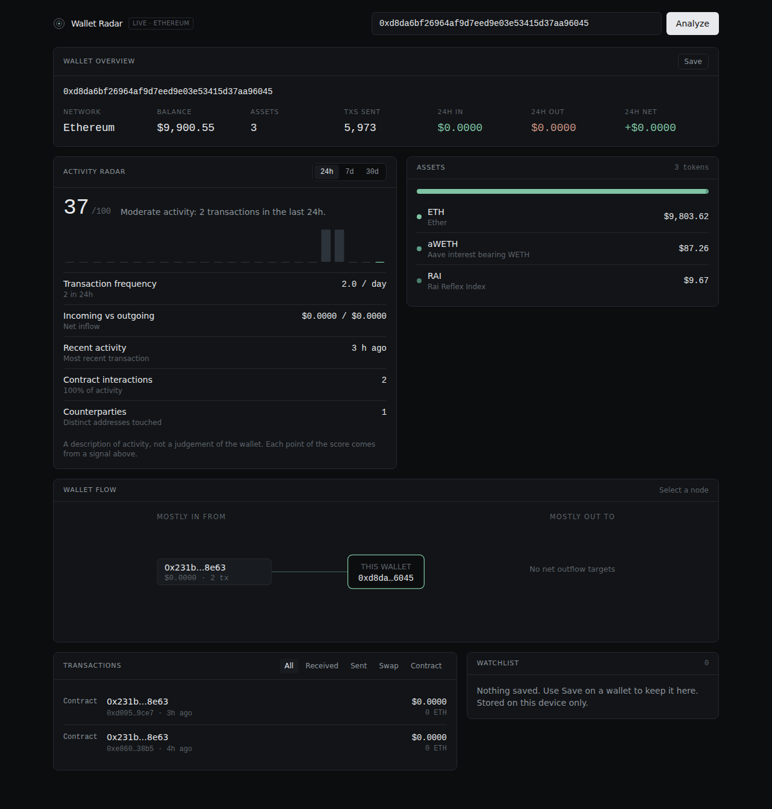

# Wallet Radar

Paste a public wallet address and understand it in seconds: overview, an explainable activity score, assets, wallet flow and a transaction feed.

**Live:** https://wallet-radar-wine.vercel.app



## Chains
Ethereum, Base, Arbitrum, Optimism and Polygon. They share the same 0x address format and one Alchemy key. To add a chain, add it in `lib/chains.ts` and enable it in the Alchemy dashboard.

## How it works
- `app/api/wallet/route.ts`: server route that holds the API key, caches for 60 s and never echoes upstream errors.
- `lib/chain.ts`: live data from Alchemy (balances, token holdings, transfers, prices). Unpriced tokens are dropped as airdrop spam. Reads at most 300 transfers each way per wallet.
- `lib/mock.ts`: deterministic mock wallets and the shared types. The Live/Mock badge switches between them.
- `components/Radar.tsx`: the whole UI. The watchlist is stored on the device only.

## Run it
```
cp .env.example .env.local   # set ALCHEMY_API_KEY
npm install
npm run dev
```
`dev` and `build` use webpack because Turbopack's PostCSS worker crashes in some sandboxes.

## Not a verdict
The Activity Score describes behaviour using visible signals. It does not say a wallet is safe or malicious.

## Known limits
- Only a few well-known Ethereum addresses carry names; other chains show shortened addresses.
- 24h price change is not shown for live data.
- Solana and Bitcoin are not supported yet.

## Licence
MIT
