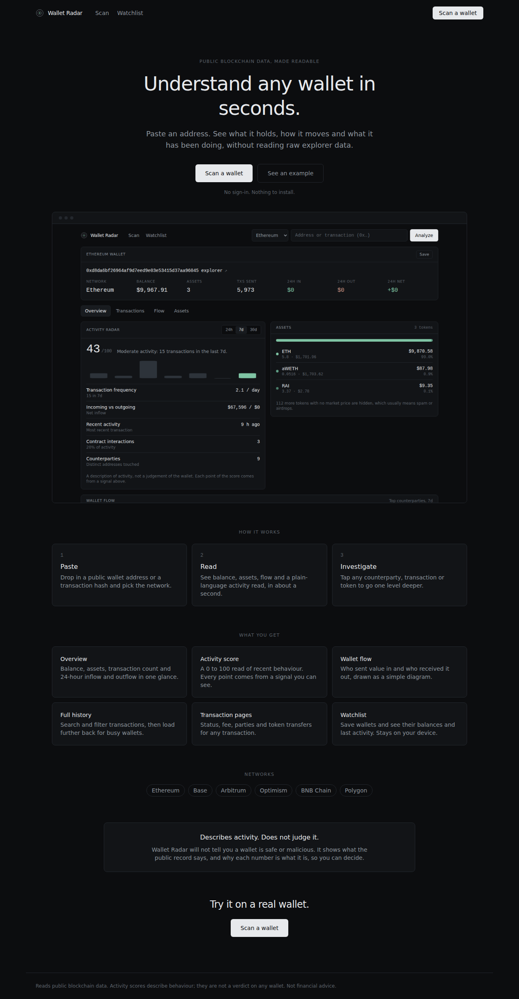

# Wallet Radar

Paste a public wallet address and understand it in seconds: overview, an explainable activity score, assets, wallet flow and a transaction feed.

**Live:** https://wallet-radar-wine.vercel.app



## Chains
Ethereum, Base, Arbitrum, Optimism, Polygon and BNB Chain. They share the same 0x address format and one Alchemy key. To add a chain, add it in `lib/chains.ts` and enable it in the Alchemy dashboard.

## Pages
- `/` landing page
- `/scan` search, samples, recent wallets
- `/wallet/<chain>/<address>` overview, then `/transactions`, `/flow`, `/assets`
- `/tx/<chain>/<hash>` transaction detail
- `/token/<chain>/<address>` token detail
- `/watchlist` saved wallets with live balances (stored on the device only)

Window, filters, search and paging live in the URL, so every view is a shareable link with its own preview card.

## How it works
- `lib/chain.ts`: live data from Alchemy (balances, holdings, transfers, prices, transaction receipts, token metadata). Prices come from DeFiLlama first (free, no key), with Alchemy as fallback. If no price source answers, the page says so instead of showing $0. Unpriced tokens are dropped as airdrop spam. Transfers are read 300 per page, up to 4 pages ("Load older activity").
- `lib/server.ts`: server-only loaders with short caches. Upstream errors are never echoed (URLs contain the key).
- `app/api/{wallet,tx,token}`: JSON routes used by the watchlist and by tests.
- `lib/mock.ts`: shared types and a deterministic mock generator.
- `components/Panels.tsx`: shared server-rendered panels.

## Run it
```
cp .env.example .env.local   # set ALCHEMY_API_KEY
npm install
npm run dev
```
`dev` and `build` use webpack because Turbopack's PostCSS worker crashes in some sandboxes.

## Not a verdict
The Activity Score describes behaviour using visible signals. It does not say a wallet is safe or malicious.

## Known limits
- Only a few well-known Ethereum addresses carry names; other chains show shortened addresses.
- 24h price change is not shown for live data.
- Wallet history is read back at most 4 pages (about 1,200 transfers each way); the page says so when a wallet is busier than that.
- Solana and Bitcoin are not supported yet; BNB Chain is supported but only its first 300 transfers each way are read.

## Licence
MIT
